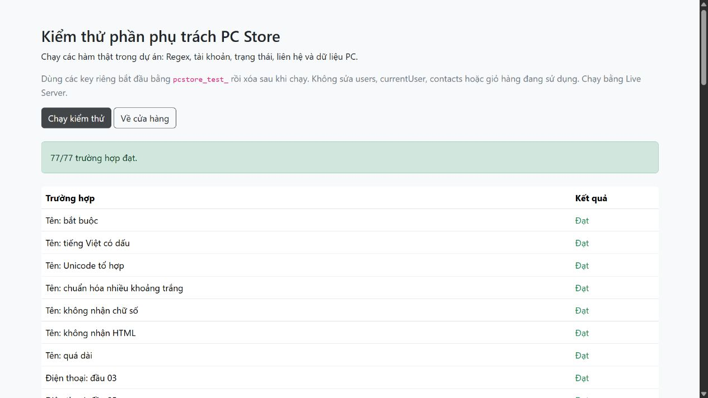

# Báo cáo kiểm thử – phần phụ trách PC Store

Ngày thực hiện: **22/10/2026**. Môi trường: trình duyệt tích hợp, website phục vụ qua HTTP cục bộ. Dữ liệu nhập là dữ liệu demo. Không gửi email, thu tiền hoặc gọi backend.

## 1. Bộ kiểm thử chạy lại được

Mở `tests/my-part.html` bằng VS Code Live Server, bấm **Chạy kiểm thử**. Kết quả đã quan sát sau lần chỉnh cuối: **77/77 trường hợp đạt**. Không ghi nhận lỗi JavaScript trong Console của lượt chạy.

Mã kiểm thử nằm ở `tests/my-part-tests.js`, gọi các hàm thực tế từ common, validation, auth, contact và products-data. Nó dùng key riêng có tiền tố `pcstore_test_` rồi dọn các key này, không ghi đè users/currentUser/contacts/cart/compare/orders của cửa hàng.

| Nhóm | Nội dung kiểm tra |
|---|---|
| Họ tên | Rỗng, tiếng Việt, Unicode tổ hợp, nhiều khoảng trắng, chữ số, HTML, vượt độ dài |
| Điện thoại | Các đầu 03/05/07/08/09; rỗng, sai đầu, thiếu/thừa chữ số, +84, ký tự chữ |
| Email | Chuẩn hóa hoa/thường, dấu +; sai @, dấu chấm, khoảng trắng, gạch nối tên miền, phần tên quá dài |
| Mật khẩu | Rỗng/ngắn/dài, thiếu hoa/thường/số, có khoảng trắng; khớp/không khớp xác nhận |
| Tổng hợp validation | Mọi hàm được gọi dù có hàm trả false |
| Tài khoản | Email trùng/mới, đăng nhập đúng/sai/tài khoản không tồn tại |
| Trạng thái | Phiên hợp lệ không trả password; phiên không có tài khoản hoặc sai email trả null |
| Điều hướng | Giữ query trang nội bộ; từ chối URL ngoài, javascript, đường dẫn không có trong danh sách |
| Liên hệ | Điền sẵn thành viên, chủ đề bắt buộc, độ dài nội dung, chuẩn hóa, userId/status/thời gian |
| Lưu trữ | Ghi/đọc JSON liên hệ; JSON hỏng hoặc sai kiểu trả mặc định; giả lập lỗi ghi trả false và giữ input |
| Hiển thị | Thông báo chứa HTML được hiển thị thành văn bản |
| PC | 24 ID duy nhất, mỗi danh mục 8 máy, đủ trường, số giá/tồn kho, nền tảng CPU/mainboard, tra cứu cùng ID |

Lỗi ghi được **giả lập bằng hàm ném exception** để kiểm tra nhánh xử lý. Chưa thay cài đặt trình duyệt để chặn localStorage thật hoặc làm đầy quota thật.

## 2. Thao tác thực tế trên các trang

| Mã | Thao tác đã thực hiện | Kết quả quan sát |
|---|---|---|
| UI-01 | Submit đăng ký trống | 5 trường báo lỗi |
| UI-02 | Tạo tài khoản với tên nhiều khoảng trắng và email viết hoa | Thành công; sau đăng nhập tên được chuẩn hóa thành Nguyễn Văn Demo |
| UI-03 | Bấm Hiện mật khẩu | Input chuyển sang type text |
| UI-04 | Bấm Đăng nhập ngay sau đăng ký, next=contact.html | URL login mang email và next; email được điền sẵn |
| UI-05 | Đăng nhập mật khẩu sai | Thông báo Email hoặc mật khẩu chưa đúng |
| UI-06 | Đăng nhập đúng từ luồng UI-04 | Chuyển về contact.html |
| UI-07 | Mở liên hệ khi đã đăng nhập | Điền sẵn tên, điện thoại, email; có đủ 4 option gồm lựa chọn rỗng và 3 chủ đề |
| UI-08 | Submit liên hệ thành viên thiếu chủ đề/nội dung | 2 lỗi; thêm chủ đề consult và nội dung thì lưu mô phỏng thành công |
| UI-09 | Tải lại trang | Header vẫn hiện tên người đăng nhập |
| UI-10 | Vào login khi đã đăng nhập | Hiện khung tài khoản hiện tại; form login được ẩn |
| UI-11 | Đăng xuất ở tab thứ hai cùng origin | Tab thứ hai về login; tab đầu hiện lại form và header Tài khoản |
| UI-12 | Đăng ký lại email đã dùng bằng chữ hoa | Lỗi trùng email dưới ô email |
| UI-13 | Từ chi tiết ID 3 bấm Tài khoản rồi đăng nhập | Trở về chính product-detail.html?id=3 |
| UI-14 | Thêm ID 3 vào giỏ và so sánh | Tên Apex 3, CPU i5-13400F, GPU RTX 4060 và giá 19.390.000đ đồng nhất |
| UI-15 | Lọc PC Gaming, giá dưới 15 triệu | 2 sản phẩm phù hợp |
| UI-16 | Đăng xuất, mở liên hệ và submit trống | 5 lỗi; nhập dữ liệu khách và chủ đề tư vấn thì gửi mô phỏng thành công |
| UI-17 | Xem đăng ký/liên hệ ở viewport 390×844 | Form hiển thị theo một cột; không tràn ngang toàn trang |
| UI-18 | Chạy lại bộ tự động sau khi tinh gọn script các trang | 77/77 đạt; không ghi nhận lỗi JavaScript |

Các lượt thử sử dụng email giả dưới miền example.com. Các bản ghi demo tạo qua UI còn trong localStorage của origin kiểm thử; không phải dữ liệu nằm trong mã nguồn và không xuất hiện mặc định khi người khác mở dự án ở origin khác.

## 3. Lỗi đã phát hiện và sửa

- Đóng thẻ option sai ở liên hệ làm mất lựa chọn Tư vấn cấu hình: tách thành hai option đúng cú pháp.
- Cùng loại lỗi ở bộ lọc PC Gaming và Dưới 15 triệu: sửa và chạy lại lọc thực tế.
- Đăng ký/đăng nhập thiếu sự tiếp nối rõ ràng: liên kết login mang email và trang quay lại; login dùng lại users.
- Trang login vẫn có form dù đang đăng nhập: thêm khung trạng thái tài khoản.
- Header trước đây chỉ đọc phiên thô: đối chiếu tài khoản tương ứng và cập nhật giữa các tab.
- Các form trước đây không bắt lỗi ghi localStorage: bổ sung saveFormData, chỉ reset/điều hướng khi lưu thành công.
- Dữ liệu PC khó sửa từng máy vì sinh bằng vòng lặp: chuyển thành 24 object khai báo trực tiếp, giữ nguyên ID và dữ liệu để các trang tiếp tục liên kết.

## 4. Kiểm tra mã nguồn bổ sung

Đã kiểm tra cú pháp toàn bộ file JavaScript tự viết, gồm bộ test. Kiểm tra tĩnh xác nhận **10 trang HTML** (9 trang cửa hàng và 1 trang test), **151 tham chiếu cục bộ** tồn tại, ID trong từng trang không trùng, không còn mẫu đóng option bị sai đã phát hiện, và 24 đường dẫn ảnh sản phẩm đều tồn tại.

## 5. Phạm vi chưa xác nhận

- Chưa kiểm tra mọi trình duyệt, thiết bị thật, trình đọc màn hình hoặc toàn bộ tổ hợp bộ lọc.
- Chưa thử hết dung lượng/chặn localStorage thật; đã thử nhánh lỗi bằng giả lập trong bộ kiểm thử.
- Chưa kiểm tra xung đột đăng ký cùng mili giây hay đồng thời từ nhiều tab; Date.now chỉ là ID demo.
- Chưa đọc Application panel sau từng thao tác UI. Lượt test tự động đã kiểm chứng ghi/đọc contacts trong key kiểm thử riêng; luồng UI đăng ký được kiểm chứng thêm bằng đăng nhập lại với tài khoản vừa tạo.
- Đồng bộ nhiều tab chỉ dành cho trạng thái tài khoản, không phải hệ thống đồng bộ đơn/giỏ/tồn kho thời gian thực.
- Không kiểm thử giao dịch hoặc bảo mật backend vì dự án không có các thành phần đó.
